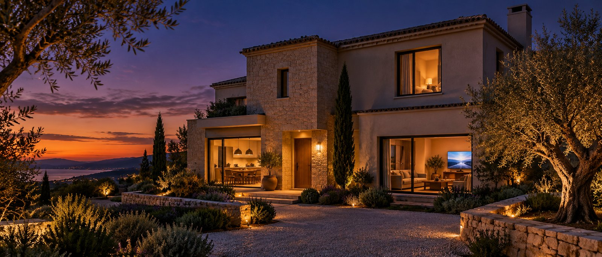
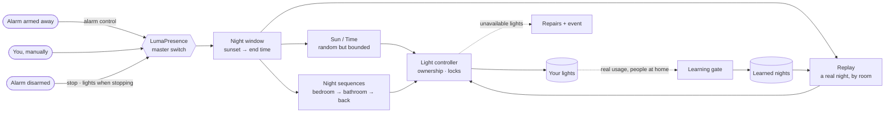
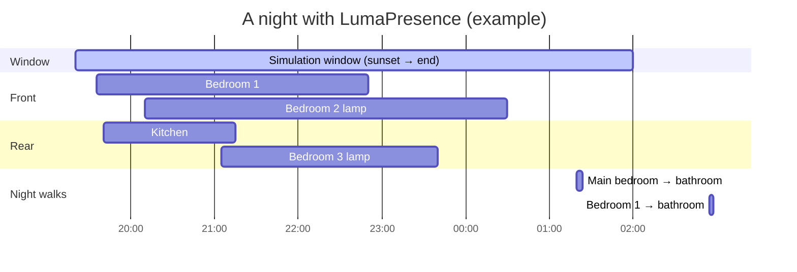
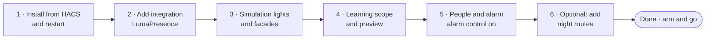
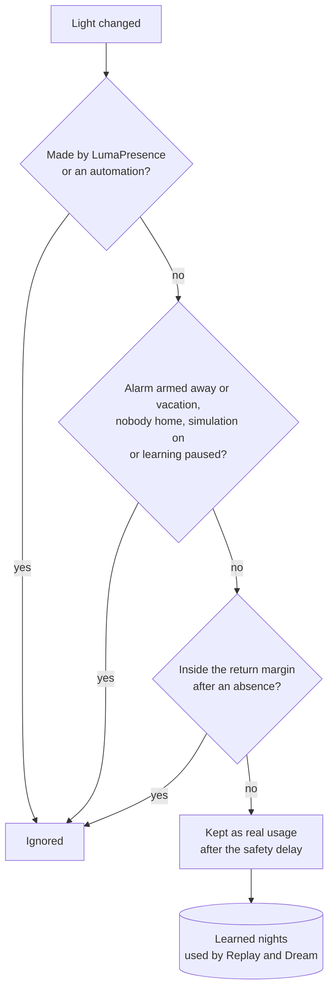

<p align="center">
  
</p>

<p align="center">
  
</p>

# LumaPresence

Presence simulation for Home Assistant that makes an empty house look lived in. LumaPresence switches lights on and off in a random but believable way, works alongside your alarm, and learns how your home is really used.

> **Status: phase 3b (v0.7.0).** Sun, Time, Replay and Dream modes, learning data collection, night sequences, built-in alarm control, context (darkness, mornings, holidays, weather) and actuator verification. Covers, ambience, deterrence and optional AI come next.

## How it works



1. **Arm the alarm** (or switch the simulation on): LumaPresence waits for its night window.
2. **During the night** it plays one mode — random but believable (*Sun*/*Time*) or a real night of your own house (*Replay*) — plus occasional night walks to the bathroom.
3. **While you are home** it quietly learns how the house is used, ignoring automations, its own actions and absences.
4. **Disarm** and it stops, never switching off a light that a person turned on.

### A typical night



## Installation (HACS)



1. In HACS, open the ⋮ menu → **Custom repositories**, add `https://github.com/jdgarcia99/ha-luma-presence` with category **Integration**.
2. Download **LumaPresence** and restart Home Assistant.
3. Go to **Settings → Devices & services → Add integration → LumaPresence**.

## Configuration

Setup walks through the same sections that the integration's **Configure** button later shows as a menu. In the menu, each section edits a working copy and returns to the menu; nothing is stored until you choose **Save**.

| Section | Options |
|---|---|
| Simulation lights | Lights and switches the simulation may control |
| Facades | Front lights and rear lights, chosen among the simulation lights |
| Learning | Indoor floors, indoor areas, extra entities, excluded entities, *Automatically exclude indicator LEDs*, and *Learn only from human actions* (ignores changes made by automations and scripts) |
| Learning preview | Read-only list of the entities that will be learned, and of the indicator LEDs left out automatically |
| People and alarm | People, alarm panel, [alarm control](#alarm-control), and the learning margins: hours discarded before an absence, and hours learning stays paused after returning |
| Context | [Darkness-based start, wake-up, daylight guard, workdays and holidays, weather](#context) (optional; only the Replay/Dream wake-up is on by default) |
| Night sequences | Delay between the steps of a route and time spent at its destination (see [Night sequences](#night-sequences)) |
| Monitoring | Minutes a light may stay unavailable before an alert (see [Unavailable lights](#unavailable-lights)), where to send the morning report, and how long to wait for a light to [obey](#lights-that-do-not-obey) |

### Facades

Each simulation light is a **front** light (visible from the street), a **rear** light (visible from the back of the house) or, by default, an **interior** light. While simulating, LumaPresence keeps at least *Minimum front lights on* and *Minimum rear lights on* lit, front first, as long as *Maximum lights on* allows it. A facade light is never switched off if that would leave its facade below its minimum, unless the house is above the maximum and there is no other light to switch off.

### Learning scope

LumaPresence learns from every real indoor light, not only from the simulation lights:

1. Every `light.*` entity in the selected floors and areas. An entity's own area wins; otherwise the area of its device is used.
2. Disabled and hidden entities, and configuration or diagnostic entities, are left out automatically. This removes status LEDs, access point LEDs and similar lights.
3. With *Automatically exclude indicator LEDs* (on by default), a light is also left out when its device has a main `switch.*` entity: smart plugs and relays (ESPHome, Shelly…) often expose their status LED as a light on the same device as the plug. Only enabled switches without an entity category count, so setting switches such as WLED's nightlight or sync switches do not; and a light that supports color or color temperature is never left out. The **Learning preview** lists these indicator LEDs so you can spot a real lamp among them.
4. **Extra entities** are added, even if a rule above left them out. Use them for room lights exposed as `switch.*` relays, for lamps without an area, and for a lamp wrongly taken for an indicator LED.
5. The simulation lights are always added.
6. **Excluded entities** are removed. Use them for lights that are not room lights, such as fridge lights or Christmas lights.

The list is recomputed a few seconds after an entity, device, area or floor changes, and each learned event stores the area of the light.

Installations upgraded from v0.1 learn from every floor that exists at upgrade time; data learned before the upgrade is kept.

## Alarm control

LumaPresence can follow your alarm panel by itself, with no automations: arming the alarm starts the simulation and disarming it stops it.

- **Enable it** in **Configure → People and alarm**: choose the alarm panel, turn on *Control the simulation with the alarm* and pick the *Alarm states that turn the simulation on* (armed away and armed vacation by default; armed home, armed night and armed custom bypass are also available). It is off by default.
- **Arming** into one of those states turns the master switch on. Other states (arming, pending, triggered, or an armed state you did not pick) never change it; a triggered alarm keeps the simulation running.
- **Disarming** turns the master switch off, and *Lights when stopping* applies as with any other stop.
- Changes coming from `unavailable` or `unknown` are ignored, so a panel reconnecting never starts or stops the simulation.
- **Manual override:** if you turn the simulation off by hand (or with a service or an automation) while the alarm is armed, it stays off until the alarm is disarmed (or set to a state you did not pick) and armed again.
- **After a restart**, LumaPresence reconciles what happened while Home Assistant was down: if the alarm is armed and the simulation is off (and you did not turn it off by hand during this arming), it turns on; if the alarm is disarmed and the simulation was turned on by the alarm, it turns off. A simulation you turned on by hand stays on, and nothing happens while the panel is unavailable.

It can replace your own arm/disarm automations, or coexist with them: turning the master switch on when it is already on, or off when it is already off, does nothing.

`switch.luma_presence_simulation` shows who turned it on in `activated_by` (`alarm`, `manual`, `service`, or `restore` when restored after a restart without a known origin) and when in `activated_at`; both are cleared when it turns off. The `luma_presence_action` events for `simulation_started` and `simulation_stopped` include the `origin` (`schedule` when the window ends).

## Replay mode

Replay reproduces a real night of your house: what the lights actually did on a recent night while the family was home.

### Why learned data and not the recorder

Replay does not read the recorder. It plays back what LumaPresence has [learned](#learning): only nights when the house was occupied, only human actions (no automations, no previous simulations), stored per day in LumaPresence's own storage. So it never replays an empty house or a past simulation, and it does not depend on how many days the recorder keeps (`purge_keep_days`).

### Window and source night

Replay uses the same window as Sun mode: from sunset or [darkness](#darkness-based-start) (plus the random start delay, if on) until the end time (or the late end time), and never after sunrise. Night sequences keep working in every mode.

A night runs from 12:00 to 12:00 the next day, so it spans two learned days, and events are matched by clock time: a light switched on at 21:14 on the source night is switched on at about 21:14 tonight. At each window start Replay picks the source night, preferring:

1. the same weekday within the last 14 days;
2. the same type of night within the last 28 days: weekday nights start Sunday to Thursday (a working day follows), weekend nights start Friday and Saturday — the same day types as Dream;
3. the most recent eligible night.

A night is eligible when LumaPresence observed at least 80 % of tonight's window on it, it has at least *Minimum events for Replay* events (4 by default) inside the window, and it was not last night's source (unless it is the only eligible one). Among equally good nights, the most recent wins.

If no night is eligible, Replay runs that night exactly like **Sun mode** and says why; it tries again the next night.

### Lights

With *Map by room* (on by default; it was called *Replay by room* before v0.6.0), each event is played in its room: if the room has simulation lights, it goes to one of them (front first, then rear, then interior, in configuration order); if the room has none, or its room is unknown, it is played on the original light. When several lights of a room map to the same simulation light, that light stays on while any of them was on. With *Map by room* off, every event is played on exactly the same light.

Events for lights that are unavailable, disabled or no longer learned are skipped.

### Playback

- Every change is shifted by a random amount of up to *Replay time variation* minutes (10 by default), keeping each light's order, at least a minute apart.
- At the window start, each light is set to the state it had at that time on the source night.
- Replay is faithful: the minimum, maximum and facade limits are not applied. A light in use by a night route gets its Replay state once the route releases it.
- During a real absence (the alarm is armed away or armed vacation, or nobody is home), Replay switches off any light of its timeline when the source night did, even if the simulation did not switch it on: a light left on when leaving follows the source night, as in Sun and Time modes. Without a real absence, for example in a test with people at home, the [ownership rule](#ownership-rule) applies: Replay only switches off the lights the simulation switched on.
- The window end works as in the other modes: lights the simulation turned on are switched off gradually.
- After a restart during the night, Replay rebuilds the same timeline and continues.

`sensor.luma_presence_replay_source` shows the source night (its start date) and, as attributes, the `reason` it was chosen (`same_weekday`, `same_day_type`, `most_recent`) or the reason for falling back (`fallback_no_data`, `fallback_not_enough_events`, `fallback_not_enough_exposure`), the number of `events` inside the window, the number of `eligible_nights` and `by_room`.

## Dream mode

Dream generates a **new** night every night, built from how your house is really lived in, so that someone watching for several nights sees an occupied home and not a loop.

### How it learns

From the [learned data](#learning) (only nights with people at home, only human actions), LumaPresence builds a **room model**, rebuilt every day at 12:00:

- A **room** is occupied while any of its learned lights is on; lights without an area count as a room of their own.
- Time is measured from each night's **sunset**, in 15-minute slots from an hour before sunset until sunrise, so the model follows the seasons.
- Nights are split into **weekday** nights (starting Sunday–Thursday) and **weekend** nights (Friday and Saturday).
- For each room and day type it estimates how often the room starts being used in each slot, how long visits last (evening, late night, small hours), which room tends to follow it within 10 minutes, and how many rooms are usually busy at once (its 95th percentile caps a dreamed night).
- Recent nights weigh more (half-life *Dream memory half-life*, 21 days by default), and **atypical** nights (far more or less activity than usual, robust z-score above 3) weigh 30 %.

### Each night

1. *Candidates per night* (20 by default) nights are simulated minute by minute over tonight's window (the Sun mode window).
2. Each one gets a **realism score** (0–100) against the model:
   `100 × (0.4 × occupancy + 0.2 × durations + 0.2 × concurrency + 0.2 × visits)`, where
   *occupancy* is 1 minus the normalised L1 distance between the expected and the dreamed occupancy of every room and slot,
   *durations* is 1 minus the Kolmogorov–Smirnov distance between dreamed and learned visit durations,
   *concurrency* is 1 minus the normalised distance between the expected and the dreamed number of busy rooms per slot, and
   *visits* is the share of rooms whose number of visits is within the expected range (expected starts ± 2 standard deviations).
3. Candidates too similar to one of the last 7 nights (*Maximum similarity with recent nights*, 0.7 by default: share of the same rooms in the same 15-minute slots) are discarded.
4. The best remaining candidate with at least *Dream minimum realism* (60 by default) is chosen; if none qualifies, the best one runs anyway with reason `low_score`.
5. Rooms are mapped to lights as in Replay (*Map by room*), the usual jitter is applied, and the plan is played like a Replay night: same ownership rule (including the [real-absence rule](#playback)), locks and restart behaviour. The plan is saved, so a restart continues the same night.

### Minimum data and fallbacks

Dream needs *Dream minimum nights* valid learned nights (14 by default, 7–60) of tonight's day type. Until then, and whenever it cannot plan a night, it falls back to **Replay**, and then to **Sun mode**; the reason is always shown.

### Transparency

- `sensor.luma_presence_realism`: tonight's score, with `source` (`dream`, `replay` or `fallback`), `reason`, `candidates`, `similarity_max` and `day_type`.
- `sensor.luma_presence_tonight_plan`: number of changes planned tonight, with the `timeline`, the `rooms` and a `summary` such as "Living room 20:10–23:40 · Kitchen 21:05–21:30".
- `sensor.luma_presence_model`: valid nights in the model, with the nights, rooms and atypical nights of each day type.
- `button.luma_presence_dream_night` and `luma_presence.dream_preview`: generate tonight's plan **without** switching anything; the plan sensor shows it with `preview: true`.
- `luma_presence.get_heatmap`: two room × hour matrices (real average occupancy and the average of 7 dreamed nights) to compare them in a dashboard.
- **Morning report**: at sunrise after a night in which the simulation or a night sequence ran, the `luma_presence_night_report` event carries the mode, source, score, rooms, lights switched and failures. Set *Send the morning report to* (**Monitoring** section) to also get a short translated notification.

### Privacy

Everything runs inside Home Assistant: the model is built locally from LumaPresence's own learned data, and only the model (not a copy of your events) is kept in memory. Nothing leaves your installation.

## Night sequences

During the night, every now and then, someone seems to get up, walk to the bathroom and go back to bed. Each walk follows a **route**.

### Routes

Add routes with **Add route** on the integration page; each one can be edited or deleted later. A route has:

| Field | Example |
|---|---|
| Name | Bathroom |
| Origin | Bedroom light |
| Path (optional, in walking order) | Hallway light |
| Destination | Bathroom light |

Route lights do not need to be simulation lights. The origin and the destination must be different, and a light can appear only once in a route.

A route turns on the origin, then each path light in order, then the destination, with a random step delay between lights. It stays at the destination for a while, then walks back: destination, path lights in reverse order, origin. Only the lights the route turned on are switched off at the end, so a light that was already on stays on.

### When sequences run

Night sequences run from *Sequence start* (`time.luma_presence_sequence_start_time`, 00:45 by default) until sunrise, only while both the master switch and *Night sequences* (`switch.luma_presence_sequences`, off by default) are on. The first route starts at *Sequence start*, plus up to 30 minutes when *Random start delay* is on; then a new route runs every *Minimum interval between sequences* to *Maximum interval between sequences* minutes (45 to 90 by default). Routes are picked at random, never the same one twice in a row when another can run, and routes whose origin or destination is unavailable are skipped.

The step delays (10 to 30 seconds by default) and the time at the destination (2 to 5 minutes by default) are set in the **Night sequences** section of **Configure**.

### Interaction with the simulation

- While a route runs, its lights are reserved: the simulation counts them for the minimum, maximum and facade limits, but never switches them.
- At sunrise, or when *Night sequences* is turned off, the running route stops and its lights are switched off gradually.
- When the master switch is turned off, the running route stops at once and its lights follow *Lights when stopping*, together with the simulation's lights.
- A route interrupted by a restart is not resumed; its lights are switched off.
- Learning ignores every light change made by LumaPresence, including routes.

To try a route at home, press **Test sequence** (`button.luma_presence_test_sequence`) or call `luma_presence.run_sequence`. It runs at once, even with the master switch off or outside the window, and does not pause learning.

## Entities

- `switch.luma_presence_simulation`: master switch. Its state is restored after a restart, and the simulation resumes if it is inside its window.
- `select.luma_presence_mode`: **Sun** (starts at sunset), **Time** (starts at a fixed time), [**Replay**](#replay-mode) (reproduces a real night) or [**Dream**](#dream-mode) (a new night generated from what was learned).
- `select.luma_presence_stop_behavior`: what to do with the lights the simulation turned on when it is stopped manually: keep them on, turn them off at once, turn them off gradually, or keep them on only at night.
- Settings: minimum and maximum lights on, minimum front and rear lights on, dwell times, switch-off interval, start, end and late end times, late arrival, and random start and end delays.
- Replay settings: `switch.luma_presence_replay_by_room` (*Map by room*, also used by Dream), `number.luma_presence_replay_jitter` (also used by Dream) and `number.luma_presence_replay_min_events`.
- Dream settings: `number.luma_presence_dream_min_days`, `number.luma_presence_dream_min_score` and `number.luma_presence_dream_half_life`; Dream sensors and button are described in [Dream mode](#dream-mode).
- Sensors: status, next event, last action, simulating, learning, valid learning days and Replay source. The last action includes `mode: replay`, and the original light when it differs, for Replay actions.
- Diagnostic sensors, to see from the device page which lights take part:
  - `sensor.luma_presence_simulation_lights`: number of simulation lights, with the `front`, `rear` and `interior` lists as attributes.
  - `sensor.luma_presence_learning_lights`: number of learned entities, with the `entities` list and the `auto_excluded` mapping as attributes. `auto_excluded` gives, for each indoor light left out automatically, the reason: `disabled`, `hidden`, `entity_category` or `indicator_led`.
- Night sequences: `switch.luma_presence_sequences`, `time.luma_presence_sequence_start_time`, `number.luma_presence_sequence_min_interval`, `number.luma_presence_sequence_max_interval`, `binary_sensor.luma_presence_sequence_running` (with the `route` and `step` attributes), `sensor.luma_presence_next_sequence` (with the configured `routes` as an attribute) and `button.luma_presence_test_sequence`.

The simulation always ends at sunrise at the latest. Scheduled ends turn the lights off gradually.

### Ownership rule

LumaPresence only turns off lights that it turned on itself and that nobody has touched since. If you come home and switch on a light, it will never turn it off.

## Learning




From day one, LumaPresence stores real usage of the lights in its [learning scope](#learning-scope) in `.storage`, per day and only while the house is occupied, so it does not depend on the recorder's retention.

Learning pauses while the simulation is enabled, the alarm is armed away or armed vacation (`alarm_armed_away` / `alarm_armed_vacation` in `paused_reasons`, with or without [alarm control](#alarm-control)), nobody is home, or it has been paused manually. Excluded days never count as days without activity: statistics are based only on observed time. After an absence longer than 48 hours, the whole day of the return is excluded.

Turning the simulation on while someone is at home is treated as a **test**, not an absence (`simulation_test` in the `paused_reasons` attribute of `binary_sensor.luma_presence_learning_active`): what was observed until then is kept, and learning starts again as soon as the test ends, with no return margin. If everybody leaves or the alarm is armed away during the test, the normal absence rules apply from that moment. Without people configured, the simulation always counts as an absence. Light changes made by LumaPresence itself are never learned.

## Context

Everything in the **Context** section is optional (only the wake-up of Replay and Dream is on by default); `sensor.luma_presence_context` shows what it changes tonight (`normal` or `modified`, with `night_type`, `night_type_source`, `weather_condition`, `bad_weather`, `boost_applied`, `evening_start_reason` and `morning_window`).

### Darkness-based start

With an *Illuminance sensor*, the evening window (Sun, Replay and Dream modes) starts when the illuminance has stayed below the *Darkness threshold* (50 lx by default) for 5 minutes, but never before *Earliest start* (60 minutes before sunset by default) nor after *Latest start* (30 minutes after sunset). If it is already dark at the earliest start, the window starts then; if it is not dark by the latest start, it starts anyway. Once an evening has started it does not move. Without readings, sunset is used. The random start delay still applies. `sensor.luma_presence_next_event` shows the reason in `start_reason`: `pending` until the start is decided (simulation off, or waiting for darkness), then `darkness`, `sunset`, `clamped_earliest`, `clamped_latest` or `sensor_unavailable`. The Dream model keeps measuring time from sunset.

### Wake-up

LumaPresence can wake the house up before dawn, as people getting ready do:

- **Start.** Sun and Time modes start at *Wake-up start* (06:30 by default; *Wake-up in Sun and Time modes*, off by default). Replay and Dream start at the time the house usually wakes up — the learned first switch-on of the morning (20th percentile, per morning type) — but never before *Wake-up start* (*Wake-up in Replay and Dream modes*, on by default; without learned mornings, *Wake-up start* is used).
- **Non-workdays (Sun and Time).** On Saturdays, Sundays and holidays (the same workday rule as the morning type), *Wake-up on non-workdays* decides: **Later** (default) starts at *Wake-up start on non-workdays* (08:30 by default; it must be later than *Wake-up start*), and **Do not simulate** skips the wake-up. The end does not change, so if it is already light by the later start there is no wake-up that day. Replay and Dream are not affected: they follow the learned mornings of each morning type. The context sensor's `morning_window` shows the rule that applied: `workday`, `nonworkday_later`, `nonworkday_skip` or `learned`.
- **End.** With an illuminance sensor, when it has been light for 5 minutes; if it is still dark, up to *Wake-up may last after sunrise* (30 minutes by default) after sunrise. Without a sensor, at sunrise.
- **Leaving before dawn.** If the master switch is turned on during the wake-up (for example when arming the alarm on the way out), it starts after a random 0–10 minute delay.
- **Morning type.** The morning of day D is a weekday morning when D is a workday (not Saturday, Sunday or a holiday) — the same rule as the night type.
- Sun and Time run the random loop with the usual limits. Replay plays the morning of its source night. Dream has a separate morning model on a clock axis (05:00–10:00, 15-minute slots) with its own rates, durations, transitions, first switch-on and typical last switch-off; it generates and scores the morning with that model, until the typical last switch-off. Night sequences and learning are unaffected.

### Daylight guard

With an illuminance sensor, a daylight guard is always active, in every mode: as soon as it has been light for 5 minutes, it stops the simulation, Replay, Dream and night routes, switches off the lights LumaPresence turned on gradually within 3 minutes, and no light is switched on while it is day (the *Test sequence* button and `run_sequence` refuse too). Without a sensor, the windows already end at sunrise.

### Workdays and holidays

With a *Workday sensor* (from the [Workday integration](https://www.home-assistant.io/integrations/workday/)), every date is classified with `workday.check_date` (cached per date): a date is not a workday when Workday says so. It is preferred over the holiday calendar. If Workday does not answer, the plain day-of-the-week rule is used and the context sensor shows `night_type_source: workday_unavailable`. Do not choose the calendar that Workday creates as the holiday calendar: its events are the **workdays**, so it is rejected.

With a *Holiday calendar* instead, any all-day event (or event covering midday) marks a holiday. The night starting on day D is a **weekend** night when D+1 is a Saturday, Sunday **or holiday**: the eve of a Wednesday holiday is a weekend night, and the holiday's own night is a weekday night because Thursday is a workday. The same rule decides the type of each morning and classifies the learned nights used by Replay and Dream. Past events are read once per range and cached for the day; if the calendar cannot be read, the plain day-of-the-week rule is used and the model sensor says so (`night_type_source: calendar_unavailable`).

### Weather

With a *Weather* entity, a night is a bad-weather night when, at the window start, the condition is rainy, pouring, snowy, snowy-rainy, lightning, lightning-rainy or hail, or it is below 8 °C. Then:

- **Dream** boosts the start rate of the two rooms busiest in the evening by *Bad weather boost* (20 % by default) and uses that same boosted model to generate and to score the candidates, so these nights are not rejected as unrealistic (`context` attribute of the realism sensor).
- **Sun and Time** keep one more light on (never above the maximum).
- **Replay** plays a real night unchanged.

## Lights that do not obey

After every command, LumaPresence waits up to *Wait for a light to obey* (10 s by default; 0 turns it off) for the light to reach the requested state, without blocking anything else. If it does not, it retries once; if it still fails, the light is marked as failed for tonight: Replay and Dream (with *Map by room*) and night routes use another light of the same room, in room-mapping order, and Sun and Time simply choose another light. Failures per light appear in the morning report (`failures: {entity_id: count}`) and its notification. After 3 failures in one night a Repairs issue says the light does not obey (it reports itself available, so this is different from the unavailable-light issue); it disappears after a night without failures.

## Unavailable lights

LumaPresence watches every simulation light, every route light, and the lights Replay uses tonight. When one stays `unavailable` or `unknown` for *Alert if a light is unavailable for (minutes)* (60 by default, in the **Monitoring** section of **Configure**; 0 turns it off), it raises a Repairs issue for that light, saying since when and what it is used for, and fires the `luma_presence_light_unavailable` event. As soon as the light reports any other state, the issue disappears and `luma_presence_light_available` is fired. After a restart, the clock starts again at startup.

Both events carry `entry_id`, `entity_id`, `since` and `roles`, so one automation can notify you about any light:

```yaml
automation:
  - alias: "LumaPresence: light unavailable"
    triggers:
      - trigger: event
        event_type: luma_presence_light_unavailable
    actions:
      - action: notify.notify
        data:
          title: "Light unavailable"
          message: >
            {{ trigger.event.data.entity_id }} has been unavailable since
            {{ trigger.event.data.since }} ({{ trigger.event.data.roles }}).
```

## Services

- `luma_presence.start` / `luma_presence.stop`: turn the simulation on or off. `stop` accepts an optional `lights_behavior` that overrides the configured stop behaviour.
- `luma_presence.forget_period`: deletes everything learned between two dates.
- `luma_presence.run_sequence`: runs a night route now. Accepts an optional `route` name; a random route otherwise.
- `luma_presence.dream_preview` (returns data): generates tonight's Dream plan without executing it.
- `luma_presence.get_heatmap` (returns data): real vs dreamed occupancy per room and hour for a day type (`weekday` or `weekend`).

## Translations

The user interface is available in English and Spanish. Contributions for other languages are welcome: add a file to `custom_components/luma_presence/translations/`.

## Roadmap

- **Phase 2** (done): night sequences (v0.3.0), Replay mode (v0.4.0) and built-in alarm control (v0.5.0).
- **Phase 3**: Dream mode core (v0.6.0), context and actuator verification (v0.7.0); then covers, ambience and deterrence, and optional generative AI.

## Development

```bash
pip install pytest-homeassistant-custom-component
pytest
```

## License

MIT
