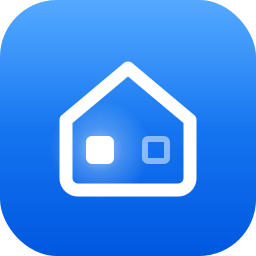

<p align="center">
  
</p>

# LumaPresence

Presence simulation for Home Assistant that makes an empty house look lived in. LumaPresence switches lights on and off in a random but believable way, works alongside your alarm, and learns how your home is really used.

> **Status: phase 1 (v0.2.0).** Sun and Time modes plus learning data collection. Alarm integration, the night sequence, and the Replay and Dream modes arrive in phases 2 and 3.

## Installation (HACS)

1. In HACS, open the ⋮ menu → **Custom repositories**, add `https://github.com/jdgarcia99/ha-luma-presence` with category **Integration**.
2. Download **LumaPresence** and restart Home Assistant.
3. Go to **Settings → Devices & services → Add integration → LumaPresence**.

## Configuration

Setup walks through the same sections that the integration's **Configure** button later shows as a menu. In the menu, each section edits a working copy and returns to the menu; nothing is stored until you choose **Save**.

| Section | Options |
|---|---|
| Simulation lights | Lights and switches the simulation may control |
| Facades | Front lights and rear lights, chosen among the simulation lights |
| Learning | Indoor floors, indoor areas, extra entities, excluded entities, and *Learn only from human actions* (ignores changes made by automations and scripts) |
| Learning preview | Read-only list of the entities that will be learned |
| People and alarm | People, alarm panel, and the learning margins: hours discarded before an absence, and hours learning stays paused after returning |

### Facades

Each simulation light is a **front** light (visible from the street), a **rear** light (visible from the back of the house) or, by default, an **interior** light. While simulating, LumaPresence keeps at least *Minimum front lights on* and *Minimum rear lights on* lit, front first, as long as *Maximum lights on* allows it. A facade light is never switched off if that would leave its facade below its minimum, unless the house is above the maximum and there is no other light to switch off.

### Learning scope

LumaPresence learns from every real indoor light, not only from the simulation lights:

1. Every `light.*` entity in the selected floors and areas. An entity's own area wins; otherwise the area of its device is used.
2. Disabled and hidden entities, and configuration or diagnostic entities, are left out automatically. This removes status LEDs, access point LEDs and similar lights.
3. **Extra entities** are added. Use them for room lights exposed as `switch.*` relays and for lamps without an area.
4. The simulation lights are always added.
5. **Excluded entities** are removed. Use them for lights that are not room lights, such as fridge lights or Christmas lights.

The list is recomputed a few seconds after an entity, device, area or floor changes, and each learned event stores the area of the light.

Installations upgraded from v0.1 learn from every floor that exists at upgrade time; data learned before the upgrade is kept.

## Entities

- `switch.luma_presence_simulation`: master switch. Its state is restored after a restart, and the simulation resumes if it is inside its window.
- `select.luma_presence_mode`: **Sun** (starts at sunset) or **Time** (starts at a fixed time).
- `select.luma_presence_stop_behavior`: what to do with the lights the simulation turned on when it is stopped manually: keep them on, turn them off at once, turn them off gradually, or keep them on only at night.
- Settings: minimum and maximum lights on, minimum front and rear lights on, dwell times, switch-off interval, start, end and late end times, late arrival, and random start and end delays.
- Sensors: status, next event, last action, simulating, learning, and valid learning days.
- Diagnostic sensors, to see from the device page which lights take part:
  - `sensor.luma_presence_simulation_lights`: number of simulation lights, with the `front`, `rear` and `interior` lists as attributes.
  - `sensor.luma_presence_learning_lights`: number of learned entities, with the `entities` list and the `auto_excluded` list (indoor lights left out automatically) as attributes.

The simulation always ends at sunrise at the latest. Scheduled ends turn the lights off gradually.

### Ownership rule

LumaPresence only turns off lights that it turned on itself and that nobody has touched since. If you come home and switch on a light, it will never turn it off.

## Learning

From day one, LumaPresence stores real usage of the lights in its [learning scope](#learning-scope) in `.storage`, per day and only while the house is occupied, so it does not depend on the recorder's retention.

Learning pauses while the simulation is enabled, the alarm is armed away, nobody is home, or it has been paused manually. Excluded days never count as days without activity: statistics are based only on observed time. After an absence longer than 48 hours, the whole day of the return is excluded.

## Services

- `luma_presence.start` / `luma_presence.stop`: turn the simulation on or off. `stop` accepts an optional `lights_behavior` that overrides the configured stop behaviour.
- `luma_presence.forget_period`: deletes everything learned between two dates.

## Translations

The user interface is available in English and Spanish. Contributions for other languages are welcome: add a file to `custom_components/luma_presence/translations/`.

## Roadmap

- **Phase 2**: alarm integration, night sequence, and Replay mode (replays your real usage from previous days).
- **Phase 3**: Dream mode (new, believable patterns generated from what has been learned, with optional AI), repairs and diagnostics.

## Development

```bash
pip install pytest-homeassistant-custom-component
pytest
```

## License

MIT
